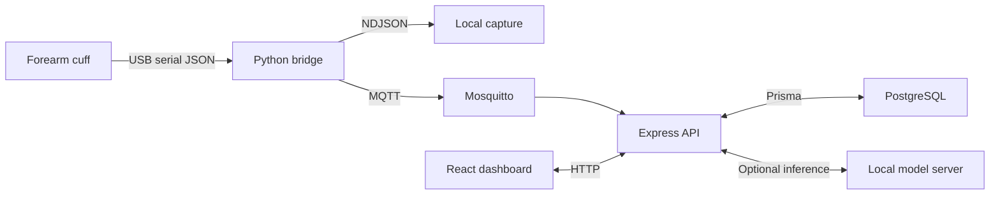

# Pulsars

Pulsars pairs a wearable forearm cuff with a locally hosted dashboard for astronaut health monitoring. A crew member can review vital trends, record a symptom, follow a checkup, and see how much movement the cuff captured that day. The 2026 NASA Space Apps prototype brings the sensor readings and the crew member's observations together on one laptop.

[Watch the project demo](https://www.youtube.com/watch?v=xLKMY4KCLbg) · [Read the Pulsars team submission](https://www.spaceappschallenge.org/2026/find-a-team/pulsars1/?tab=project) · [Run Pulsars locally](#run-locally)

> La vida empieza con un pulso.

## Contents

- [The mission](#the-mission)
- [What you can try](#what-you-can-try)
- [How it works](#how-it-works)
- [Run locally](#run-locally)
- [Connect the cuff](#connect-the-cuff)
- [Data and verification](#data-and-verification)
- [Project roadmap](#project-roadmap)

## The mission

On longer missions, microgravity affects muscles and bones, and a conversation with a doctor on Earth can be delayed. Pulsars explores what a crew member can record and review on board while awaiting ground support. We used NASA's *The Human Body in Space* to frame the monitoring problem and its astronaut exercise research to motivate tracking movement alongside vital signs. The demo uses readings from the cuff or the included simulator. [NASA Space Apps project](https://www.spaceappschallenge.org/2026/find-a-team/pulsars1/?tab=project#details) · [The Human Body in Space](https://www.nasa.gov/humans-in-space/the-human-body-in-space/) · [Astronaut Exercise](https://www.nasa.gov/missions/station/iss-research/astronaut-exercise/) · [Earth-independent medical operations](https://www.nasa.gov/centers-and-facilities/ames/ames-science/ames-space-biosciences/a-clinical-decision-support-system-for-earth-independent-medical-operations/)

## What you can try

| View | What it does |
| --- | --- |
| **Dashboard** (`/`) | Shows recent heart rate, oxygen saturation, and body-temperature readings from the API. Each card shows the latest value and a trend. The cuff supplies usable fingertip pulse and experimental SpO₂. Its forearm skin temperature appears in Fitness. |
| **Fitness** (`/fitness`) | Shows active time by day and intensity, movement bouts, and gaps in sensor coverage. Open a bout to see valid pulse or skin-temperature readings and their timestamps. The Mobility, Light Cardio, Steady Cardio, and Resistance checklists include durations, repetitions, and rest intervals. A manual completion appears on today's timeline and persists after a reload. |
| **Symptom Log** (`/symptom-log`) | Records symptom type, severity, and notes. Saving a symptom starts a follow-up thread with Vela, the assistant. The backend can give the model recent vitals and relevant symptom history for context. |
| **Checkups** (`/checkups`) | Opens assigned questionnaires, saves answers, and shows completed checkups. The API supports separate patient and medic records and checkup assignment. |

The routine library is designed for the Earth-based demonstration. [NHS sitting exercises](https://www.nhs.uk/live-well/exercise/sitting-exercises/) · [NHS strength exercises](https://www.nhs.uk/live-well/exercise/strength-exercises/) · [CDC physical activity intensity](https://www.cdc.gov/physical-activity-basics/measuring/index.html)

## How it works



| Part | Placement and signal |
| --- | --- |
| **Seeed Studio XIAO ESP32C3** | Controller on the forearm. USB-C powers the demo and carries serial data to the laptop. |
| **MAX30101** | Sits under the index fingertip for optical pulse and experimental oxygen saturation. Steady contact helps the firmware obtain a usable reading. |
| **MPU6050** | Mounted with the cuff so acceleration and rotation reflect forearm movement. |
| **DS18B20** | Sits against the inner forearm. The firmware reports skin temperature once the reading settles. |

The USB bridge enables Fitness automatically. Each window has ten one-second sample slots. The separate vitals session starts on usable fingertip contact, allows 15 seconds for stabilization, and records for 60 seconds. Today's Fitness view and the Dashboard refresh every five seconds.

Fitness counts active seconds when at least five seconds in a window reach a motion threshold. The starting thresholds are **0.06 g or 15°/s** for Light, **0.15 g or 35°/s** for Moderate, and **0.35 g or 80°/s** for High. These bands describe forearm movement. The calendar uses the browser's time zone. Quiet periods can group gaps of up to 30 seconds, with the missing time shown separately. A bout can show a timestamped pulse or temperature reading from up to 30 seconds before or after it. [Activity classification](backend/src/modules/fitness/activity.ts)

## Run locally

Use Git, Node.js 24 with npm, and Docker with Compose. Python 3.10 or later is needed to connect the cuff. Use a demo database and keep services on loopback. The current patient view selects a user ID through configuration and the API is unauthenticated.

```bash
git clone --branch skraftyy/dev --single-branch https://github.com/turtlevlz/Pulsars.git
cd Pulsars
```

### 1. Start PostgreSQL, MQTT, and the API

From the checkout, open a terminal and run the following. The sample configuration uses PostgreSQL on port `5433`, Mosquitto on `1883`, and the API on `3000`.

```bash
cd backend
[ -f .env ] || cp .env.example .env
docker compose up -d --wait postgres mosquitto
npm ci
npm run db:deploy
npm run build
npm run db:seed
npm start
```

The build generates the Prisma client used by the seed. A fresh seed creates demo users, including Alice Patient at ID `2`. Leave the API running. [API health check](http://127.0.0.1:3000/health)

### 2. Start the dashboard

Open a second terminal at the checkout. The sample frontend environment selects patient `2` and routes browser requests through Vite's `/api` proxy.

```bash
cd frontend/Pulsars
[ -f .env ] || cp .env.example .env
npm ci
npm run build
API_PROXY_TARGET=http://127.0.0.1:3000 npm run preview -- --host 127.0.0.1 --port 4173
```

For either setup block in Windows PowerShell, replace the `.env` copy line with `if (!(Test-Path .env)) { Copy-Item .env.example .env }`. Before starting the frontend preview, run `$env:API_PROXY_TARGET = 'http://127.0.0.1:3000'` on its own line, then run `npm run preview -- --host 127.0.0.1 --port 4173`. [Open the local dashboard](http://127.0.0.1:4173/)

### 3. Try a software-only demo

Inside `backend` in a third terminal, run `npm run simulate -- 2 1000 10`. This sends ten sets of synthetic heart rate, body temperature, and oxygen values for demo patient `2` through MQTT. Open Dashboard to see the trends. For Fitness motion data, connect the cuff below.

To try an assigned checkup on a freshly seeded database, send the following JSON to `POST http://127.0.0.1:3000/checkups`, then open Checkups as patient `2`.

```json
{
  "userId": 2,
  "medicId": 1,
  "name": "Crew sleep check-in",
  "questions": ["How long did you sleep?", "How rested do you feel?"]
}
```

### Optional local assistant

Start Ollama on the laptop and run `ollama pull llama3.2`. The backend defaults to `LLM_URL=http://localhost:11434/v1` and `LLM_MODEL=llama3.2`. Log a symptom from Dashboard to start a thread. The backend sends symptom context to the configured endpoint and stores the conversation in PostgreSQL. It can ask fallback questions when the model is unavailable. The team's notes also record a MedGemma 1.5 4B trial through Ollama. [Model configuration](backend/src/config.ts) · [Assistant evaluation notes](backend/docs/plan.md)

## Connect the cuff

Use the wired firmware profile, **0.2.3**. If the cuff already runs that version, start the bridge. To flash a cuff, install Arduino CLI, the Espressif ESP32 board package, and the ArduinoJson, OneWire, and DallasTemperature libraries. Close serial monitors and the bridge before uploading. Substitute the device port shown by `arduino-cli board list` for `/dev/ttyACM0`, for example `COM3` on Windows. [Espressif board installation guide](https://docs.espressif.com/projects/arduino-esp32/en/latest/installing.html)

```bash
arduino-cli board list
arduino-cli compile --fqbn 'esp32:esp32:XIAO_ESP32C3:CDCOnBoot=default,PartitionScheme=huge_app' --build-property 'compiler.cpp.extra_flags=-DPLAN_A_COMPETITION -DPLAN_A_USB_DEMO' --build-path device/.build/fitness-usb device/firmware/bracelet
arduino-cli upload --fqbn 'esp32:esp32:XIAO_ESP32C3:CDCOnBoot=default,PartitionScheme=huge_app' --input-dir device/.build/fitness-usb --port /dev/ttyACM0 --verify device/firmware/bracelet
```

Open another terminal at the checkout and start the USB receiver. Match `--pulsars-user-id` to `VITE_USER_ID` in `frontend/Pulsars/.env`.

```bash
cd device/bridge
python3 -m venv .venv
.venv/bin/python -m pip install -r requirements.txt
.venv/bin/python -u tools/receiver.py --usb --port auto --pulsars-user-id 2
```

On Windows PowerShell, use `py -m venv .venv` and replace each `.venv/bin/python` with `& '.\.venv\Scripts\python.exe'`. If more than one matching USB device is connected, pass the cuff's port explicitly. To use a different host port for Mosquitto, set `MQTT_PORT` in `backend/.env` for Compose and use that port in `MQTT_URL` and the bridge's `--pulsars-mqtt-port`.

With the bridge running, plug the cuff in and open Fitness. Seat the probe against the inner forearm. Check the live-data indicator, then make a few sustained forearm rotations at the bench and open the resulting activity entry. Rest your fingertip against the optical sensor during a quiet interval to capture pulse context. The bridge writes local `.ndjson` captures under `device/bridge/captures`. [Open the local Fitness page](http://127.0.0.1:4173/fitness)

## Data and verification

| Interface | Contract |
| --- | --- |
| **USB** | `get_status` with `fitness: true` enables `fitness_window`. A window includes the device ID, boot ID, window start in device uptime, and ten slots carrying `motion_rms_g`, `gyro_rms_dps`, `pulse_bpm`, and `skin_temp_c`. Unavailable slots or fields are `null`. |
| **MQTT vitals** | `pulsars/<patientId>/vitals/{hr,bo,bt}` accepts `{ value, recordedAt }`. The bridge publishes valid `hr` and `bo` samples from the vitals session by default. A separate body-temperature source can use `bt`. |
| **MQTT Fitness** | `pulsars/<patientId>/fitness/window` carries `v`, `deviceId`, `bootId`, `deviceTimeMs`, UTC `recordedAt`, and `samples`. The bridge publishes at QoS 1 and derives timestamps from device uptime. The API counts each patient/device/boot/window combination once. |
| **Fitness API** | `GET /users/:id/fitness/{calendar,day,routines}` takes an IANA `timeZone` and, for calendar or day, a `month` or `date`. `PUT /users/:id/fitness/routines/:key/completion` takes a JSON `timeZone` and records a completion once per local day. |

| Directory | Start here |
| --- | --- |
| [`frontend/Pulsars/`](frontend/Pulsars/) | React and TypeScript dashboard, routes, and API clients. |
| [`backend/`](backend/) | Express routes, MQTT ingestion, Prisma migrations, simulator, and backend plan. |
| [`device/firmware/bracelet/`](device/firmware/bracelet/) | ESP32 Arduino firmware, sensor sampling, and transport profiles. |
| [`device/bridge/`](device/bridge/) | Python USB receiver, MQTT publisher, and synthetic protocol examples. |

Run `npm test` in `backend` after building and starting PostgreSQL. It uses a separate test database and exercises ingestion, activity classification, local-day boundaries, and the API. In `frontend/Pulsars`, run `npm run lint` and `npm run build`. In `device/bridge`, run `.venv/bin/python -B -m unittest discover -s tests` or use the PowerShell Python invocation above. Firmware host tests are in [`device/tests/`](device/tests/).

## Project roadmap

The wired demo is a bench prototype. Its optical estimates, display ranges, motion labels, and assistant output require validation before clinical or flight use. The branch includes experimental Bluetooth LE and local Wi-Fi firmware and receiver profiles. The end-to-end Fitness demo uses USB-C.

- Add authenticated clinician access for reviewing histories, sending checkups, and sharing reports. The API already stores user roles, checkup assignments, and per-user vital averages.
- Evaluate personalized trends with habitat context such as oxygen and humidity, and design synchronization for intermittent links to Earth.
- Validate the cuff against reference instruments and controlled movement, then qualify wireless capture and reconnect behavior across the same dashboard workflow.

Built by team Pulsars for the 2026 NASA Space Apps Challenge, **Create Health Monitoring Software for Astronauts on Space Missions**. [Project and team](https://www.spaceappschallenge.org/2026/find-a-team/pulsars1/?tab=project)
